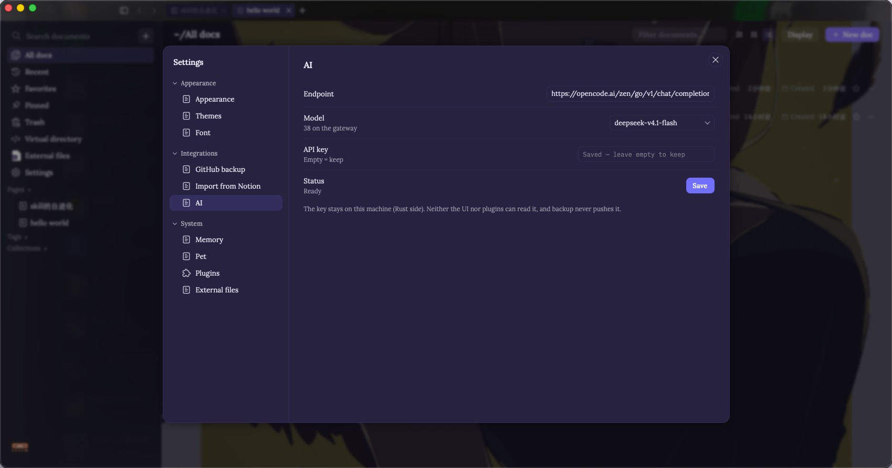

# self-notion

[English](README.md) | **中文**

[**下载 macOS 版（Apple Silicon）→**](https://github.com/tju-tomorrow/self-notion/releases/latest)
　·　包没有签名，Gatekeeper 会拦一下，怎么过见 release 说明。

**给一个人用的、极小极快的本地 Notion 底座。** 桌面端（macOS），纯本地，默认不联网，不登录。

不是 Notion 的替代品，也不是要发布的产品 —— 是**我自己的写作 + 扩展平台**。
文档在本地 SQLite（Yjs）；编辑器是自己的 ProseMirror。上面那一层（插件、AI、给 agent 的检索面、知识库）是自己长的。

> 架构主线参考 **DeepSeek Harness（DSH）的「一切皆插件」**，内核直接用它的内核 Cordis。见第四节。

## 特别的是这几件

下面这几件是这个仓库不一样的地方。后文里同一批用 **特别** 标出。

**一个文件，一份投影，三处用。** 文档、全文索引、图片、评论、版本、界面状态都在 `self-notion.db`。正文投影成 Markdown 之后，grep、虚拟目录、GitHub 备份读的是同一份。两个窗口打开同一篇时，Rust 只转发 Yjs 字节，不另存一份。语音条的原声也在这个库里，转写用本机 Whisper，模型下过一次就不再上传。

**目录名就是查询。** 整库投影成一棵目录树。`by-tag/`、`links/to/`、`search/` 是查询，不是另建的文件夹。同一篇笔记同时出现在多处。Agent 用 `ls` / `grep` / `cat`。语义检索是后来多挂的 `/search/semantic/`：没配 embedding 就剩一句说明，虚拟目录和 grep 照旧。

**助手能改笔记，撤销权不在模型手里。** 写之前先问你，这次对话可以改成自动执行。真正落库前由 Rust 打快照。一次回答改了几篇，撤销按回合一起退。API key 只在 Rust 和钥匙串里。外部 agent 走 MCP：读在 app 关着时也能进行；写只入队，等这个应用开着，用编辑器自己的解析器执行。

**功能是一个目录。** 内核只装载、卸载、解析依赖，不认识「文档」。编辑器也是插件。卸掉一个目录，系统回到装载前。

**库可以离开这扇窗口。** 手机上是一份完整副本，电脑关机也能打开改，回到同一 Wi-Fi 再双向同步，没有账号。磁盘上的 Markdown 目录可以挂进侧栏，按真实文件夹展开。


---

## 一、有哪些功能

**写作**
- 块编辑器是自己的 ProseMirror：段落 / 标题 / 列表 / 待办 / **折叠** / 引用 / 代码（高亮，配色可换）/ 公式 / Mermaid / 分割线 / 表格 / 图片 / 附件 / 标注 / **语音条** / **drawio 画布**
- 中文斜杠菜单、Notion 快捷键、拖拽块、查找替换、右侧大纲、页内书签（划线打点，右上角跳回）
- 子页面、`@`提及、文档互链、双向链接与反链
- **特别 · 语音**：正文里录音留成一条语音条，点「转文字」走本地 Whisper（下过一次之后离线）；光标处也可以直接说
- 选中的字可以朗读

**组织**
- 侧栏文档树（新建 / 改名 / 移动 / 删除）、**多标签**、**多窗口**（Dock / 菜单各开一窗）
- 首页（列表 / 网格、按更新时间分组，列表虚拟滚动）、收藏、最近、置顶、回收站（只读，可恢复）
- **特别 ·** 磁盘上的 Markdown 目录可以挂进侧栏，按真实文件夹展开
- **特别 · 手机网页版（PWA）**：装到主屏幕就是一份完整副本。电脑关机也能打开读写；同一 Wi-Fi 下再和桌面双向同步。没有账号、没有云端

**检索**
- **⌘K 全文搜索**（SQLite FTS5）：上半搜索框、下半左分段列表 + 右正文预览，三份缓存预取
- **特别 · 虚拟文档目录**：整个库投影成目录树，`tree/` `by-tag/` `by-date/` `by-topic/` `links/to/` `search/` …
  目录名就是查询条件。只读浏览页在侧栏；对 agent 暴露成 MCP 工具
- **特别 · 知识库**：后台策展人整理标签、主题和关联；拿不准的进收件箱等人点；另有一张笔记关系图。语义检索是目录里的 `/search/semantic/`，没配 embedding 就降级成一句说明，不另起一套检索

**AI**
- **内置助手**：整页 + 右侧那一列。多轮对话、思维链、思考强度可调。可以圈定笔记和关联来答，能贴图，一次圈多个范围
- **特别 · 可写，但先问人**：写操作默认弹出确认，本次对话可以改成自动执行。真正落库前 **Rust 仍强制打快照**，撤销按「回合」（一次回答改了 3 篇 → 一次全撤）
- 历史是侧栏里一条可开关的窄栏，按今天 / 近几天 / 更早分组，不把正文挤掉
- 回复可复制、可朗读；表格按真表格画
- 每篇的一句话 / 一段话总结 + 实体
- **网页版 AI 侧栏**：把 chat.deepseek.com / chatgpt.com 装进右侧一列（原生子 webview，登录常驻），选中正文一键填进它的输入框
- **特别 · MCP**：`self-notion --mcp` 是另一个进程。读是只读直连库，电脑上的 app 没开也能 grep；写只往队列里放一条请求，等 app 开着用编辑器自己的解析器执行


**评论 / 版本**
- 评论：页面 / 块 / 行内三种锚点，回复、解决、删除
- 版本历史：顶栏时间线面板；打点在 AI 写入前 / 文档关闭 / 每 10 分钟

**数据**
- **图片粘贴零等待**：字节直写 SQLite，按 sha256 去重，本地零额外目录
- **GitHub 单向推 Markdown 备份**（默认关，能在网页上读、能 diff）
- **Notion 导入**：HTML 导出 zip → 每篇成文档，文件夹层级 → 父子层级，图片进库


**外观 / 外壳**
- 无边框 + 毛玻璃窗口。界面主题四套：原版 / Claude / Notion / 夜空。正文深浅可调，代码块另有配色
- **正文纸面**（底色 + 磨砂）、三级字体（全局 / 文章 / 代码）
- 中英双语、快捷键速查、侧栏底部**像素宠物**、菜单栏内存监控

**扩展**
- **特别 · 一切皆插件**：功能 = 一个插件目录（`plugins/` 41 个，启动时装 40 个；旧的 `editor-blocksuite` 留着不装），卸掉它系统精确回到装载前的样子
- 应用内扩展市场（装 / 卸 / 启停，第三方插件跑在 module Worker 沙箱里）—— **规划中**

---

## 二、相比 Notion，优势在哪

标了 **特别** 的行就是上一节那几件。其余几行是本地写作应用的底子。

| # | self-notion | Notion |
| --- | --- | --- |
| 1 | **特别 · 数据是一个文件**：`self-notion.db`（SQLite），在你自己的盘上，不登录、默认不联网。一份 Markdown 投影，grep、虚拟目录、备份三处读 | 云端 SaaS：要账号、要订阅、断网基本不能用，数据在别人的服务器上 |
| 2 | **极小极快**：Tauri 2 外壳，**不打包浏览器引擎**；标签免费、窗口贵 | Electron 级体积；网页版每次打开都要加载一整个 App |
| 3 | **特别 · 一切皆插件，卸掉即完全撤销**：内核只管装载 / 卸载 / 解析依赖，不认识「文档」是什么 | 封闭：只有 API 外挂，核心不可扩展 |
| 4 | **特别 · 给 agent 的虚拟文档目录**：整个库投影成目录树，目录名就是查询条件，agent 用 `ls` / `grep` / `cat`。语义检索只是多挂的一个目录 | 没有这个东西。Notion AI 是黑盒问答 |
| 5 | **特别 · 可写、先问人、且一定可回退的内置 AI**：BYO endpoint，能改你的笔记。写之前先确认（本次对话可改成自动执行），**落库前强制快照**，撤销按「回合」。外部 agent 的写也要经过开着的编辑器 | Notion AI 生成的内容混进正文，回退靠手 |
| 6 | **图片粘贴零等待**：字节直写 SQLite，按内容 sha256 去重；本地零额外目录 | 「上传中…」 |
| 7 | **特别 · 多窗口开同一篇文档，真的是一份数据**：Rust 做 CRDT 中继（Yjs 本来就是 CRDT） | 同一页面多窗口打开会互相覆盖 / 只读 |
| 8 | **GitHub 单向推 Markdown 备份**（默认关），给你一个能读、能 diff、能带走的出口 | 导出是「功能」，不是持续备份 |
| 9 | **编辑器和外壳都是自己的**：块编辑器是 ProseMirror，菜单、快捷键、主题和纸面质感全部自写 | 只能等官方排期 |

### 1 展开：为什么「一个 .db」是个优势

磁盘上只有 `self-notion.db` 一个文件（外加备份产物）。文档、全文索引、图片附件、评论、版本、UI 状态全在里面。

```sql
documents    文档元数据（父子树 / 收藏 / 回收站）    ← Rust 是唯一真相源
doc_snapshot  Yjs 状态快照
doc_update    Yjs 增量（顺带就是版本历史）
doc_version   版本点（AI 写入前 / 文档关闭 / 每 10 分钟）
doc_fts       FTS5 全文索引
doc_text      Markdown 投影 ┐
doc_link      链接图谱（@提及 + 子页面）│ 一份投影，三处复用：
blob          图片 / 附件（id = sha256）┘ grep 语料 · vfs:read 内容 · 备份产物
comment       评论（锚点在正文，解决状态在这）
meta          键值（含全部 UI 状态）
```

代价写在 `positioning.md`：库外看不到图，想单独拿一张要走导出。

### 4 展开：虚拟文档目录（这是 Notion 完全没有的一层）

```
/
├── index.md      自动生成：统计 · 标签 · 最近
├── tree/         唯一的真实层级
├── by-tag/  by-date/  by-topic/  recent/  favorites/
├── links/to/<doc>.md    反链（找上下文最快的一条路）
├── links/from/<doc>.md  出链
├── search/<q>/          动态：一次查询 = 一次目录列举
├── search/semantic/<q>/ 可选。没配 embedding 时目录里只有一句说明
├── graph/neighbors/  entity/  proposals.md
└── outline/  trash/
```

**目录 = 查询。** 同一篇文档同时活在多个目录下 —— 组织方式变成无限、可组合、不需要预先建模的东西
（Notion 只有一棵树）。

**为什么主路不上 RAG：** DCI（2026）在同一 benchmark 上把 embedding 换成 grep，准确率 69% → 80%，
成本降三成；Mintlify 换掉 RAG 后 p90 会话创建 46s → 100ms。更重要的不对称是：
**向量检索失败得像真的，grep 失败得像失败。**

语义检索后来挂成 `/search/semantic/<q>/` 这一个目录。没配 embedding 就降级成一句说明。
虚拟目录、grep、`doc_fts` 一条都没断，向量不是另一套地基。

暴露方式是 **MCP 工具**（`self-notion --mcp` 独立进程：读只读，写只入队），不是 FUSE。

### 5 展开：AI 可问可写，先问人，但一定退得回去

- **Key 不出 Rust** —— 用户填的 baseURL / model / key 只活在 Rust + macOS Keychain，webview 拿不到明文
- **AI 不能决定自己不可撤销** —— 「写之前先快照」这个顺序由 **Rust 强制**，不交给模型自觉
- **撤销的单位是「回合」不是「文档」** —— 一次回答改了 3 篇 = 同一个 `group_id`，一次全撤
- **只用快照，不用 `Y.UndoManager`** —— 后者的栈在内存里，关掉文档就没了



改正文仍然是 `create` / `append` / `replace`（按块 id），外加改名、移动、打标签。**不做整篇覆盖**（丢块元数据），**没有删文档的工具**。落库前先过人确认，本次对话可以改成自动执行。

---

## 三、代价与明确不做（不回避）

- **编辑器和外壳都是自己写的** —— ProseMirror 的 schema、块和快捷键在 `editor-prosemirror`；侧栏、标签条、搜索、设置从零做。旧的 BlockSuite 插件还在仓库里，启动时不装。省下的是 AFFiNE 那 113 MB 渲染层和 53 MB 的 `@affine/core`
- **内存有底价** —— 只要还用 webview 画界面，单窗口就有下限。要压到 30–60 MB 必须不用 webview，等同于重写编辑器（已排除）
- **一切皆插件是有开销的** —— 多一层内核 + 每个插件要有 manifest 和生命周期纪律
- **第三方插件默认只能在沙箱里组合现有能力** —— 纯前端 JS，碰不到盘和网，**不能自带 Rust 代码**（刻意的）
- **备份意味着数据会离开这台机器** —— 所以「纯本地」重述为「默认纯本地，联网只发生在你显式开启的功能上」

不做（已封版）：数据库多视图（Notion 的灵魂，D-0008）· 协作白板（笔记里的 drawio 是单块图，不是那块白板）·
账号 / 云同步 / 团队协作 · 日记 / 模板库 · 网页嵌入 / 网页书签 ·
遥测埋点 / 自动更新

> **一句话判据：如果这个功能不能让我「写得更快」或「更容易扩展」，就不做。**

**还没做的**：应用内扩展市场。多视图数据库、协作、账号和云同步仍然不做。

---

## 四、架构：参考 DeepSeek Harness 的「一切皆插件」

**这一条是 D-0031 / D-0032 的用户决策：**「参考 deepseek harness 的架构，让我扩展起来很简单，
甚至让别人也可以扩展」「有一个扩展市场，我每次做一个新功能都可以很简单的插拔」。

### 抄了什么

DSH 的**理由**先说服了我们：在 Claude Code / Codex 里，harness 是一个固定外壳，只能通过 MCP / API 扩展，
**永远不可替换**。DSH 把这条线挪了 —— harness 本身就是插件拼的，「产品」和「扩展」的边界不存在。
它的四个预设模式（Standard / PTC / Minimal / Creative）**不是四份代码，是四份插件清单**。

于是：

1. **内核 = Cordis**（npm 上的 `cordis`，MIT，Koishi 作者 Shigma 抽出，核心约 2000 行 TS、**零运行时依赖**）。
   不自己发明 —— DSH 自己也是 vendor 它，而不是重写。内核只干三件事：**装载 / 卸载 / 解析依赖**，
   它不认识「文档」「编辑器」「侧栏」这些词。**编辑器本身也是插件**
2. **两个原语就是「简单插拔」的全部含义**
   - `inject` —— **依赖驱动的装载**：缺依赖不装载，依赖消失自动卸载、回来自动重装。
     效果：把 `storage` 从 SQLite 换成别的，`editor` 一行都不用改
   - `ctx.effect` —— **可逆副作用**：通过 `ctx` 注册的一切（监听器 / 命令 / 槽 / 块类型）卸载时**逆序自动撤销**，
     **你永远不手动调 disposer**。顺带白拿 HMR
3. **格式照抄 bundle / profile / manifest** —— `selfNotion.bundle` → `sn.patch.yml`，
   清单写法与 DSH 的 `dsh.bundle` → `cordis.patch.yml` 一致

### 哪些地方刻意不照抄

| 维度 | DeepSeek Harness | self-notion |
| --- | --- | --- |
| 内核 | Cordis（vendor 成 `@deepseek-ai/cordis`）| **`cordis`（直接用 npm 包）** |
| 清单 | `dsh.bundle` → `cordis.patch.yml` | `selfNotion.bundle` → `sn.patch.yml` |
| 分发 | `dsh plugin add`（底层转发 pnpm）| **应用内市场** —— 桌面应用不能假设用户装了 node |
| 热装载 | 启动时读 patch，社区得自己写 `dsh-hot-installer` 补 | **第一版就做进内核**，不让社区去补 |
| 沙箱 | mods 无沙箱（**被点名的问题**）| **webview + Tauri capability 双重边界** |
| 缺 manifest | 静默失效 | **管理页明确报警** —— DSH 审计里 101 个插件只有 11 个开箱即用，主因就是这个；我们不吃这个亏 |
| 自我改造 | agent 写插件热挂（`cordis_define` / `cordis_run`）| 留口子，先不做 |

**安全那条最要紧**：DSH 被点名的正是「插件能碰文件、会话和 agent 的决策路径，而 mods 无沙箱」。
我们的第三方插件是**单文件 ESM，跑在 module Worker 里** —— **Worker 里没有 DOM、摸不到
`window.__TAURI_INTERNALS__`**，所以「恶意插件能不能偷偷调 IPC」这个问题根本不成立。
（这条还顺手躲开了一个 CSP 漏洞：原方案 Blob → `import()` 撞 `CVE-2026-95626`，让原方案能跑起来的那一步
正好是官方认定为漏洞的那一步。）

### 内核理论来源

Cordis 的可组合性拆成两维（论文《A Programming Paradigm for Spatiotemporal Composability》，
DeepSeek-AI + 北大，2026-08-13，**预印本、尚无同行评审**）：**时间维**（可逆副作用）+
**空间维**（反应式余效应），并给出 **path independence** 这条可测性质 —— 我们把它做成 CI 测试：
**随机装卸插件 N 次，最终状态快照必须逐字节一致。**

> 动机数字很扎心：**VSCode top 100 扩展里有 87 个运行时无法单独卸载。**（D-0033）

### 一页纸

```
┌──────────────────────────────────────────────────────────┐
│  WKWebView（每个窗口一个）                                  │
│   Cordis 内核 —— 只干三件事：装载 / 卸载 / 解析依赖          │
│      │ inject（声明依赖）    │ ctx.effect（可逆副作用）      │
│   plugins/  ← 目录即插件，没有任何集中的注册表               │
│      唯一对外通道：ctx.rpc                                 │
└──────────────────────┬───────────────────────────────────┘
                       │ 通用入口 api({ method, args })
┌──────────────────────▼───────────────────────────────────┐
│  Tauri 核心进程（Rust）—— 能力提供方，不插件化                │
│   SQLite（Yjs / FTS5 / blob / version）· 文件 · 备份 · AI   │
│   · VFS · 事件广播 · 多窗口 CRDT 中继                       │
└──────────────────────────────────────────────────────────┘
```

**三条主张**

1. **内核极小，一切皆插件** —— 加功能 = 加一个插件目录；卸掉它，系统精确回到装载前的样子
2. **Rust 管能力，前端管组合** —— 数据、文件、网络全在 Rust；界面和插件全在 webview
3. **契约只有一个类型源** —— `apps/desktop/src/kernel/contract.ts`，命令走一个通用入口，
   漂移由 `cargo test` 守（D-0049）

**命令命名空间**：`doc` `search` `blob` `settings` `backup` `vfs` `kb` `ai` `aiweb` `voice` `sync` `version` `mcp` `mem` `window`

**多窗口**：一个 Tauri 进程唯一持有 SQLite；多窗口 = 再开一窗；**窗口内多标签是一个 state 数组**
（标签免费，窗口贵）。两个窗口开同一篇文档时，谁的 update 来了 Rust 就广播给其他窗口 ——
**Rust 不解析 Yjs，只做字节转发**。

### 实现落点：一个功能一个插件目录

`apps/desktop/plugins/` 下 41 个目录，启动时装 40 个（`editor-blocksuite` 留着不装）。**目录即插件，卸掉任何一个应用照常跑。**

| 插件 | 做什么 |
| --- | --- |
| `editor-prosemirror` | `ctx.editor`。ProseMirror；斜杠菜单、快捷键、拖块、评论锚点、语音条、画布块 |
| `plugin-storage` | `ctx.docs` —— 编辑器—存储契约，**只有三个方法** `load` / `save` / `delete` |
| `shell-sidebar` `shell-tabs` `shell-nav` `shell-doc-header` `shell-settings` | 外壳：文档树、标签条、前进后退、面包屑 + ⋯ 菜单、设置页 |
| `home` | 没有打开文档时那一页（列表虚拟滚动 / 网格 / 按更新时间分组） |
| `search-panel` | ⌘K 全文搜索（FTS5）：左分段列表 + 右正文预览，三份缓存 |
| `blob` | 图片 / 附件：粘贴 / 拖拽 / 选文件 → 按 sha256 进库，**粘贴零等待** |
| `comment` | 页面 / 块 / 行内三种锚点，回复、解决、删除 |
| `version-history` | 顶栏时间线面板 + 打点（切走 / 每 10 分钟 / AI 写入前） |
| `ai` `tools` | 内置助手。读虚拟目录、按范围检索、改笔记；写之前先问人；撤销条按回合 |
| `ai-summary` | 每篇的一句话 / 一段话总结 + 实体，存盘 |
| `ai-web` | 网页版 AI 装进右侧一列（原生子 webview，常驻保活），选中正文一键填进输入框 |
| `read-aloud` | 选中的字、助手的回复，走现成的朗读 |
| `vfs` | `ctx.vfs` —— 虚拟文档目录，只读浏览页 |
| `kb` `kb-inbox` `kb-graph` | 策展人、建议收件箱、关系图。语义检索挂在虚拟目录上 |
| `drawio` | 画布标签。点开笔记里的画布块；`@maxgraph/core` 用到才装 |
| `voice-input` | 语音输入。本地 Whisper，下过一次后离线 |
| `theme` `code-theme` `appearance` | 四套界面主题 / 代码配色 / 语言、纸面、正文深浅、快捷键 |
| `external-files` | 把磁盘上的 Markdown 目录挂进侧栏 |
| `mobile-sync` | 手机版设置：地址、配对码、证书。服务在 Rust |
| `agent-bridge` | 外部 agent 的写请求。MCP 只入队，开着的应用用编辑器执行 |
| `export` | 设置页里导出当前文档 |
| `backup-github` | GitHub 单向推 Markdown，设置页 + 建库选库 |
| `import-notion` | Notion HTML 导出 zip → 每篇成文档（文件夹层级 → 父子层级，图片进 blob） |
| `mascot` `mem-monitor` | 侧栏像素宠物（帧是程序化生成的）；菜单栏内存数字（**把 WebContent 算进去**） |
| `bugs` `perf-monitor` `web-sync-status` | 诊断和同步状态，卸掉不影响写作 |
| `plugin-rpc` `plugin-settings` `plugin-command` | 内核服务：到 Rust 的唯一通道 / 键值设置 / 命令注册表 |

---

## 五、技术栈

| 层 | 选型 | 版本 |
| --- | --- | --- |
| 外壳 | Tauri 2（不是 Electron） | ^2 |
| 内核 | Cordis（MIT，零运行时依赖） | `4.0.0-rc.10` |
| 编辑器 | ProseMirror（自己的 schema 和块，**本身就是一个插件**） | `prosemirror-view` ^1.42 |
| 按需装载 | 画布 `@maxgraph/core`；语音 whisper.cpp；代码高亮 highlight.js；公式 katex；图 mermaid | |
| 渲染 | React 19（只用核心 API，留 Preact 开关） | ^19 |
| 数据 | SQLite（WAL）存 Yjs update；FTS5 全文；blob 进库 | Yjs 13.6.33 |
| 样式 | vanilla-extract。编辑器不再吃 BlockSuite 的 `--affine-*` | |
| 包管理 | pnpm workspace | 10.18.0 |

类型：TS `strict`、禁 `any`；Rust 2021、`clippy -D warnings`。

---

## 六、上手

```sh
pnpm install
pnpm dev                    # 开发（Tauri + Vite）
pnpm build                  # 构建

pnpm verify                 # tsc + oxlint + cargo clippy -D warnings（改完只跑这一个）
pnpm logs                   # 尾随 errors.log
```

**所有能拦住你跑起来的错误都落进同一个文件** —— 前端界面右上角也会浮出最后几条，不用开 DevTools：

```
~/Library/Application Support/app.selfnotion.desktop/errors.log
```

---

## 七、目录结构

```
self-notion/
├── app.png                 产品图标（1254² 源图，`pnpm tauri icon app.png` 铺全套）
├── images/                 README 里用的截图
├── apps/desktop/
│   ├── plugins/            ★ 目录即插件，一个目录一个功能
│   ├── src/kernel/         契约 contract.ts + Cordis 装载器 + 槽位 + 错误出口
│   ├── src/shell/          外壳骨架（只搭骨架挂槽位）
│   ├── src/ui/             跨插件复用的 UI（确认框、轻提示、设置行）
│   └── src/{theme,i18n}/
├── src-tauri/
│   ├── icons/              打包图标（`tauri icon` 生成，改图标只改 app.png 再跑一次）
│   └── src/                能力提供方
│       ├── store/          SQLite：schema.sql · docs · blob · comment · version · links · summary · kb
│       ├── commands/mod.rs ★ 唯一的命令入口 api()
│       ├── ai/  vfs/  kb/  voice/  mcp/  backup/  syncing/
│       └── aiweb.rs · windows.rs · mem.rs · log.rs
└── CONVENTIONS.md          并行施工时的法律
```

---

## 八、施工纪律（改代码前先读 `AGENTS.md`）

1. **注释要少** —— 只写一句话说**为什么**，决策理由进决策台账
2. **不写 `*.test.ts`** —— 用打印验证
3. **出错只有一个出口** —— `errors.log`，不要往 `console.log` 里丢错误
4. **只写自己插件目录里的文件**；只通过 `ctx` 拿能力；**每加一个 `register()` 必须写出它的 `unregister()`**
5. **验收自带两条**：装载能用 + **卸载后应用不崩**

---

## 九、许可

本项目 [MIT](LICENSE)。

直接依赖的许可证：**MIT** —— ProseMirror、BlockSuite（仓库里还在，启动不装）、Cordis、React、React DOM、Yjs、zod、fflate ·
**MPL-2.0** —— `@toeverything/theme` · **BSD-3-Clause** —— `lit` · **Apache-2.0 OR MIT** —— `@tauri-apps/api`。

唯一要留意的是 `@toeverything/theme`：我们是原样 import 它的 CSS，没有改它的文件，
所以 MPL-2.0 那种「文件级」copyleft 够不到本仓库。改了它的文件，义务就变了。
